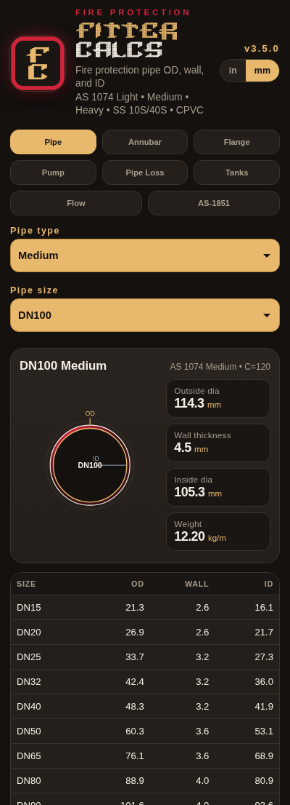
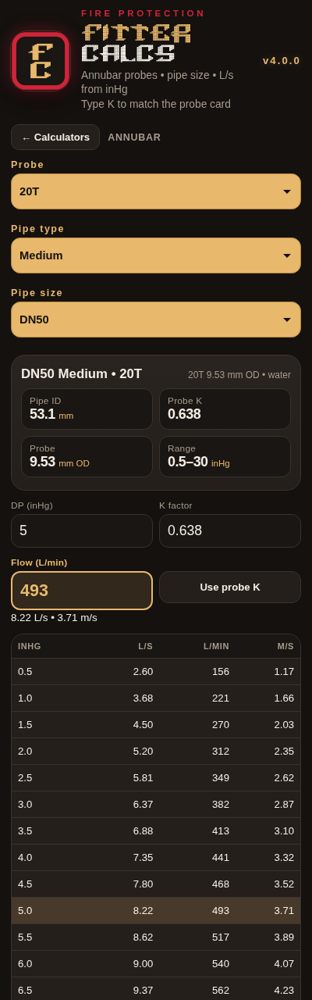
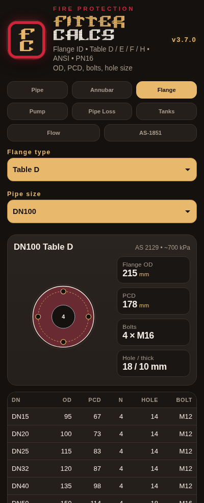
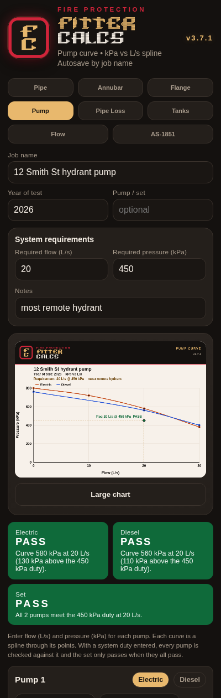
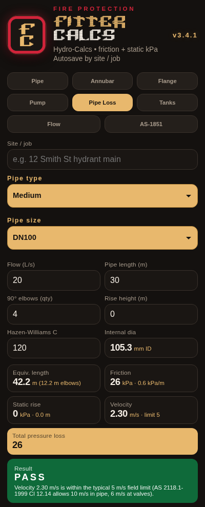
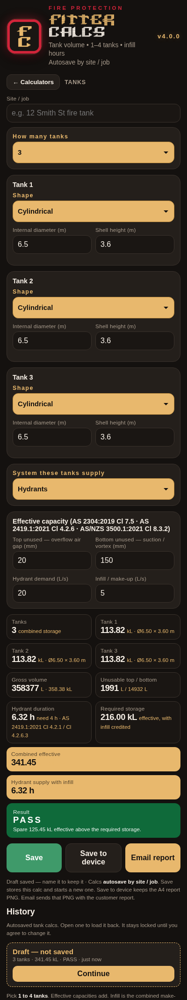
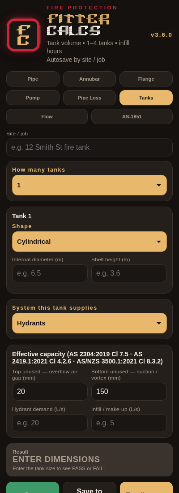
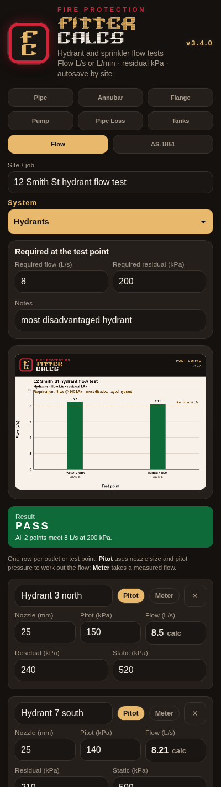

# FitterCalcs

<p align="center">
  
  <br>
  
</p>

<p align="center">
  Field calculator for fire protection fitters.<br>
  AS 1074 pipe sizes, Annubar flow, flanges, pump curves, hydro losses, tanks with infill hours vs AS 2419.1 / AS 2118.1, and AS 1851 lookup.
</p>

<p align="center">
  <strong>Current version: 3.4.1</strong><br>
  <a href="https://github.com/macski777/fittercalcs/releases/latest">Download FitterCalcs.apk</a>
  ·
  <a href="https://github.com/macski777/fittercalcs/releases/tag/v2.46">Windows</a>
  ·
  <a href="https://github.com/macski777/fittercalcs/releases/tag/v2.46">Linux</a>
</p>

## Logo

The launcher icon and the **FITTER / CALCS** wordmark use **Delta Corps Priest 1** (CoSMiC cHiLD / FIGlet). Body text in the app is the original system sans font.

<p align="center">
  
  &nbsp;&nbsp;
  
</p>

## Install on Android

1. Download [FitterCalcs.apk](https://github.com/macski777/fittercalcs/releases/download/v3.4.1/FitterCalcs.apk).
2. If this phone already has FitterCalcs and Android refuses the new file, uninstall the old app once, then install this one.
3. Open the file on the phone.
4. Allow install from this source if Android asks.
5. Open **FitterCalcs**. Each person creates their own account. Pump, hydro, and tank jobs stay with that name.

Needs Android 7 or newer.

## Install on Windows

1. Download [FitterCalcs-Setup.exe](https://github.com/macski777/fittercalcs/releases/download/v2.46/FitterCalcs-Setup.exe).
2. Double-click it. No admin, no wizard — it is a portable Windows app.
3. Pin it to the taskbar or copy it to the Desktop if you want it handy.

From **2.44** the Windows app checks for a newer build when it opens. Click **Update** and it downloads the new exe, replaces this one, and restarts. Copies older than 2.44 need this one download. After that they update themselves.

**Windows is still on 2.46.** The 3.x builds are Android-first; a matching Windows build will be published separately. Until then the Windows app may see the Android release version and report that the update has no Windows download.

Needs 64-bit Windows 10 or 11.

## Install on Linux

1. Download [FitterCalcs-linux.tar.gz](https://github.com/macski777/fittercalcs/releases/download/v2.46/FitterCalcs-linux.tar.gz).
2. Unpack it and run `./install.sh` (installs for your user only).
3. Open **FitterCalcs** from the app menu, or run `fittercalcs`.

Needs Python 3, GTK 3, and WebKitGTK 4.1:

```bash
# Arch / Omarchy
sudo pacman -S python-gobject webkit2gtk-4.1

# Debian / Ubuntu
sudo apt install python3-gi gir1.2-gtk-3.0 gir1.2-webkit2-4.1
```

## Updates

From **2.18** the phone checks this repo when it opens. From **2.44** the Windows app checks the same file.

- A red **Update** banner appears when a newer build is online.
- An Android notification is posted as well.
- Tap **Update** to download and install. On Windows that replaces `FitterCalcs-Setup.exe` and restarts the app.
- Tap the version number (top right) to check by hand.

Phones on **2.17 or older** need a one-time install of 2.18 or later (USB or this page). Windows copies older than **2.44** need one download of that build. After that they update themselves.

## What’s in the app

| Tab | What it does |
| --- | --- |
| **Pipe** | OD, wall, ID for AS 1074-1989 (R2018) Cl 2.3 Tables 2.1 / 2.2 / 2.3 Light / Medium / Heavy, SS 10S, SS 40S, CPVC. mm or inch. |
| **Annubar** | Type L/min or inHg for 3/8", 20T, and 21T. Table is 0.5–30 inHg in 0.5 steps; highlights the next 0.5 inHg up. Medium-steel card K; other walls interpolate by ID. |
| **Flange** | AS 2129-2000 Tables D/E/F/H, ANSI 150/300, PN16 — OD, PCD, bolts, holes. |
| **Pump** | One or two pumps on the same chart, each marked **Electric** or **Diesel** and checked against the same duty. kPa vs L/s curve, autosave by job. Green **PASS** / red **FAIL** per pump plus a set result, neutral until a duty is entered. Email cites AS 2941-2013 Cl 10.3, AS 2419.1:2021 Cl 4.2.7.1.2, AS 2118.1:2017 Cl 14.9, AS 1851-2012 Table 3.4.3. |
| **Pipe Loss** | Hazen-Williams friction + static rise. Green **PASS** / red **FAIL** on typical 5 m/s (AS 2118.1-1999 Cl 12.14 is 10 m/s pipe / 6 m/s valves), neutral until flow and length are entered. Autosave by site / job. **Save to device** writes the A4 PNG. Email cites AS 1074 Cl 2.3, AS 2118.1:2017 Cl 14.10, AS 2419.1:2021 Cl 4.2.7.1.2. |
| **Tanks** | 1–4 tanks, combined effective kL. Hydrants 4 h (AS 2419.1:2021 Cl 4.2.1 / Cl 4.2.6.3). Sprinklers 30/60/90 min (AS 2118.1:2017 Cl 9.3 / Cl 10.3 / Sec 11). 20 mm overflow (AS/NZS 3500.1:2021 Cl 8.3.2). Stays neutral until every tank has a size and a demand is entered. Autosave by site / job. **Save to device** writes the A4 PNG. |
| **Flow** | Hydrant and sprinkler flow tests. Hydrants in **L/s**, sprinklers in **L/min**. Pitot mode (nozzle mm + pitot kPa) or a metered flow. Two bars per outlet — flow on the left axis, residual on the right — each green/red against the requirement. Every point must meet it. Autosave by site / job, A4 report. |
| **AS-1851** | Field lookup for AS 1851-2012 routine service. System and frequency are dropdowns. Not a substitute for the Standard. |

### Pipe

AS 1074-1989 (R2018) Cl 2.3 Tables 2.1 / 2.2 / 2.3 Light, Medium, and Heavy steel, plus stainless and CPVC. Cross-section, OD / wall / ID, mm or inch.

<p align="center"></p>

### Annubar

3/8", 20T, and 21T. Type **L/min** and the table (0.5–30 inHg, steps of 0.5) highlights the next **0.5 inHg** up (1.2 → 1.5). Type inHg to see the flow. 20T/21T K is from the medium steel card; other walls interpolate by ID.

<p align="center"></p>

### Flange

AS 2129-2000 Tables D, E, F and H, ANSI, and PN16 — OD, PCD, bolts, hole size.

<p align="center"></p>

### Pump

kPa vs L/s curve, job autosave, large chart. **+ Add second pump** puts a standby beside the duty pump. Each pump is marked **Electric** or **Diesel**, gets its own points, and both are checked against the one system duty — the tab shows a result per pump and a set result that passes only when they all pass. The chart draws each pump in its own colour with a legend. **Email report** is an A4 PNG plus a PASS/FAIL letter citing AS 2941-2013 Cl 10.3, AS 2419.1:2021 Cl 4.2.7.1.2, AS 2118.1:2017 Cl 14.9 and AS 1851-2012 Table 3.4.3.

<p align="center"></p>

### Pipe Loss (Hydro-Calcs)

Hazen-Williams friction plus static rise. Velocity within 5 m/s is green **PASS**; above is red **FAIL** (typical field limit — AS 2118.1-1999 Cl 12.14 allows 10 m/s in pipe, 6 m/s at valves). Calcs **autosave by site / job**. **Save to device** writes the A4 report PNG (same sheet as email). **Email report** cites AS 1074-1989 Cl 2.3 Tables 2.1–2.3, AS 2118.1:2017 Cl 14.10 and AS 2419.1:2021 Cl 4.2.7.1.2.

<p align="center"></p>

### Tanks

Pick **1 to 4 tanks**, each cylindrical or rectangular. Effective volumes add. Pick hydrants, sprinklers, or both; type infill / make-up. Hydrants **4 h** (AS 2419.1:2021 Cl 4.2.1 / Cl 4.2.6.3). Sprinklers **30 / 60 / 90 min** (AS 2118.1:2017 Cl 9.3 Light, Cl 10.3 Ordinary, Section 11 High Hazard). Combined systems: AS 2419.1:2021 Cl 4.2.3. Overflow default 20 mm: AS/NZS 3500.1:2021 Cl 8.3.2. Vortex / capacities: AS 2304:2019 Cl 7.3.5 / Cl 7.5. Enough storage is green **PASS**; short is red **FAIL**. Calcs **autosave by site / job**. **Save to device** writes the A4 report PNG.

<p align="center"></p>

### Results and saved reports

A result only turns green **PASS** or red **FAIL** when it has real site data. With a field still empty the tab shows a grey **ENTER DIMENSIONS**, **ENTER DEMAND** or **ENTER READINGS** card instead, so a leftover default can never be mistaken for a result.

<p align="center"></p>

Red is used only for **FAIL** and destructive actions; menus, tabs and buttons are gold. A partly sized tank set stays neutral too — it will not read **PASS** until every tank has a size.

Saved reports open **locked**. Tapping a field to read it, or scrolling past one, changes nothing and asks nothing; the **Change this saved report?** prompt appears only when you type into a field or press a control. Work that has no site name yet is kept in **History** as a **Draft — not saved** row, with **Continue** to return to it.

### Flow

Hydrant and sprinkler flow tests. Pick **Hydrants** or **Sprinklers**, enter the requirement, then one row per outlet or test point.

- **Hydrants** measure in **L/s**. **Sprinklers** measure in **L/min**. Switching system converts the values so the same physical flow is kept.
- **Pitot** — nozzle size in mm and pitot pressure in kPa. The app works out the flow with `Q = 0.0666 × d² × √P` and shows it live, converted to the selected unit.
- **Meter** — type the measured flow from a flow meter or Annubar.

The chart shows two bars per outlet: **flow** on the left axis and **residual pressure** on the right, with dashed lines at the required flow and required residual. Each bar turns green or red against its own requirement, and the flow and pressure are printed under the outlet name. Every tested point must meet the required flow and residual for the test to pass. Tests autosave by site, appear in History, and produce the same A4 report as the pump tab.

<p align="center"></p>

### Annubar K

- **20T** (single-mount 3/8″) and **21T** (dual-mount 3/8″) use the medium steel card: DN50 **0.638**, DN65 **0.617**, DN80 **0.665**, DN90 **0.661**, DN100 **0.672**, DN125 **0.671**, DN150 **0.706**.
- Light, Heavy, SS 10S, SS 40S (Sch 40 ID), and copper interpolate that K against mill ID. DN200+ holds the DN150 K.
- **3/8″** still uses the Diamond II formula. You can still type a K from another card. **Use probe K** puts the table/formula back.

## Ask Stillo — document assistant

A floating **Ask Stillo** button opens a chat panel that answers questions from the documents in `~/Documents/FitterDocs` on the server. It uses DeepSeek (`deepseek-flash`) with a local full-text index; only the matching passages and the question are sent.

- Access is limited to the names in `~/.config/fittercalcs/assistant.json`; admins always have access.
- The DeepSeek key lives in `~/.config/fittercalcs/assistant.env` (mode 600). Never commit it.
- Admins get a gear button in the panel to upload, rescan, or remove documents. PDFs, Word, Excel, PowerPoint, text, Markdown, CSV, HTML, email and scanned images are supported.
- Answers cite the document, clause or table, and page. If the answer is not in the library, the assistant says so instead of guessing.
- Click a source chip or a `[n]` citation to read the exact clause/table passage in the panel. **Open PDF at page** opens the original page; **Copy text** copies the passage.
- On a phone, swipe right on the source reader to go back to the answer.
- Android back (the system gesture/button or an inward edge swipe) closes the source reader first, then Ask Stillo.
- Tap the microphone to dictate a question. Tap **Read aloud** on an answer or source, or turn on **Read answers** in the footer. The native voice bridge is in the **3.2.x Android APK**; desktop Chrome uses browser speech. If device speech fails, the server provides a fallback voice.
- Older editions are labelled; add the current edition to the library when you have it.

Index commands on the server:

```bash
python3 knowledge.py sync          # add or update documents
python3 knowledge.py stats         # documents, pages, chunks
python3 knowledge.py search "AS 2419.1 hydrant storage"
python3 knowledge.py ask "What are the hydrant storage requirements?"
```

The index is stored in `~/.local/share/fittercalcs/assistant/knowledge.db`. It is not part of the public repo, and neither are the documents or the API key.

The assistant is a search aid, not a substitute for the current Standard. The phone and desktop app pick it up automatically when online because they load the server UI; the offline fallback does not include it.

## Field use

This is a site tool, not a certified hydraulic design or a replacement for mill cut sheets, probe charts, or the current Standard. Confirm before you cut, drill, or sign off a test.

## Publish a new version (maintainer)

Bump `versionName` / `versionCode` in `app/build.gradle` and `APP_VERSION` in the HTML, build the APK, then:

```bash
./publish-update.sh "Short note for the update banner"
```

That updates `update.json`, pushes `main`, and attaches `FitterCalcs.apk` to a GitHub release. Phones on 2.18+ pick it up next time they open the app.

The build is signed from `keystore.jks` in the project root, pinned in `app/build.gradle`. Keep that file. If it goes missing the build stops rather than signing with a random debug key — a different certificate makes Android refuse the update as a different app, which is exactly the **App not installed** error. `keystore.jks` is gitignored and never published.

Windows and Linux installers are uploaded by hand to the release; set `FITTERCALCS_WIN_URL` when running the script if you want `update.json` to advertise the Windows build.
